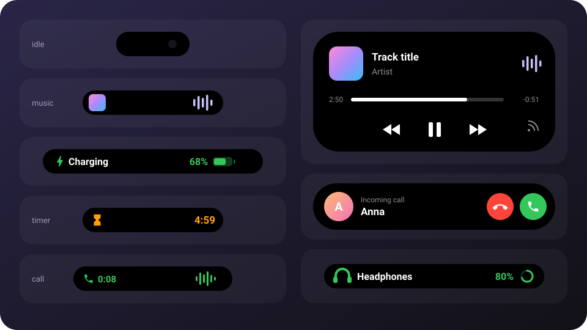
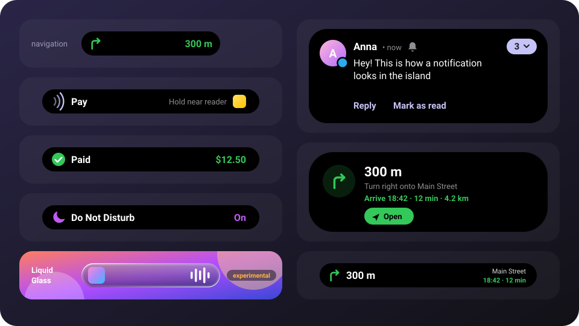

<p align="center">
<a href="README.md"></a>&nbsp;&nbsp;<a href="README.en.md"></a>
</p>

<div align="center">

# 🏝️ Dynamic Island for Android

**An iPhone-style Dynamic Island around the camera of any Android phone**

Notifications with reply · navigation · payments · music with lyrics · calls · timers · downloads · charging · flashlight · system events

[](https://github.com/Akira9021/Dynamic-Island-/releases/latest)
[](https://github.com/Akira9021/Dynamic-Island-/releases)
[](https://github.com/Akira9021/Dynamic-Island-/actions)
<br>




### [⬇️ Download the latest version](https://github.com/Akira9021/Dynamic-Island-/releases/latest)

[What's new](#-whats-new-in-160) · [Features](#-features) · [Installation](#-installation) · [Gestures](#-gestures) · [Settings](#-settings) · [How it works](#-how-it-works)

</div>

> [!NOTE]
> The app's interface is currently in Russian. Below, setting names are given in English with the Russian label in brackets, so you can find them in the app.

---

## ✨ What's new in 1.6.0

<div align="center">

</div>

| | |
| --- | --- |
| 🔔 **Big notification banner** | Like the notification shade: an avatar with the app badge, the name, an unread counter, the text and the notification's own buttons — "Reply" (type right inside the island) and "Mark as read" |
| 🧭 **Navigation, rides, deliveries** | A wide banner when navigation starts, then a capsule with the turn arrow and distance; expanded — where to turn and "Arrive 18:42 · 12 min · 4.2 km". 2GIS, Yandex Navigator and Maps, Google Maps, Yandex Go, Uber, Yandex Eats |
| 💳 **Payments** | The contactless symbol when you open a bank or wallet app; when the bank confirms a payment — a green check and the amount |
| 🫧 **Liquid Glass** · *experimental* | Glass that catches the light: highlights, a glowing rim, a colored fringe; the highlights shift as you tilt the phone. Off by default |
| 🎨 **Button color** | Lavender, system (Material You), from the avatar or custom |
| 🔄 **In-app updates** | A "Version is available" card with Update / Later buttons; after updating — what changed |
| 🌙 **Do Not Disturb** | A moon and the state when the mode switches |
| ⚙️ **Settings** | iOS-style colored icons; capsule width with an activity and animations in their own categories |
| 🔋 **Battery** | With the screen off the tilt sensor and navigator screen reading sleep; the glass renders faster |
| 🧹 **Removed** | Volume control, the lyrics line in the capsule, island width and height (position stays) |

Full list of changes — [CHANGELOG.en.md](CHANGELOG.en.md).

## 📱 Features

<table>
<tr><th>Card</th><th>In the capsule</th><th>On tap</th></tr>
<tr><td>🎵 <b>Music</b></td><td>Artwork to the left of the camera, a sound wave in the artwork color on the right</td><td>Artwork, title, synced lyrics, seeking, ⏪ ⏸ ⏩, audio output</td></tr>
<tr><td>📞 <b>Calls</b></td><td>Incoming — avatar, name and buttons right away; during a call — a phone with the time and a wave</td><td>Name, duration, End</td></tr>
<tr><td>⏳ <b>Timer</b></td><td>An hourglass and a countdown, the last 10 seconds in red</td><td>A remaining-time ring around pause, cancel; at the end — an alarm and vibration</td></tr>
<tr><td>⏱️ <b>Stopwatch</b></td><td>Time</td><td>Pause, reset, stop</td></tr>
<tr><td>⏰ <b>Google Clock</b></td><td>A timer or stopwatch from the notification, screen recording in red</td><td>Large time, open the app</td></tr>
<tr><td>⬇️ <b>Downloads</b></td><td>The app icon and a progress ring (Google Play, Telegram…)</td><td>Name, bar and percentage</td></tr>
<tr><td>🔦 <b>Flashlight</b></td><td>A yellow icon</td><td>A card with a beam like in iOS 18: swipe for brightness (Android 13+), tap to turn off</td></tr>
<tr><td>🔔 <b>Notifications</b></td><td>A big banner: an avatar with the app badge, the name, the text and Reply / Mark as read buttons</td><td>Reply right inside the island; tap opens the app, swipe up dismisses</td></tr>
<tr><td>🧭 <b>Navigation, rides, deliveries</b></td><td>The turn arrow and distance, for rides and deliveries — the arrival time</td><td>Where to turn, arrival time, travel time, Open</td></tr>
<tr><td>⚡ <b>Charging</b></td><td>A bolt, percentage and a battery</td><td>A charge bar</td></tr>
<tr><td>🕐 <b>Idle island</b></td><td>A small capsule above the camera</td><td>Clock, date, battery, a 1–99 min timer, stopwatch, flashlight</td></tr>
</table>

If there are two activities — say, music and a timer — the second one moves into a round **bubble** next to the island. Tapping the bubble expands it.

### 🔔 Events

Short notices in the capsule, each can be turned on separately:

| | | |
| --- | --- | --- |
| ⚡ Charging started / stopped | 🪫 Low battery (5%) | 📶 Wi-Fi connected / disconnected |
| 🎧 Headphones connected / disconnected (with battery) | ✈️ Airplane mode | 🔕 Ring / vibrate / silent |
| 🔆 Adaptive brightness | 🔌 USB device | 🔓 Unlock |
| 🌙 Do Not Disturb | 💳 Hold near reader | ✅ Paid |

## 📥 Installation

1. Download **`DynamicIsland.apk`** from the [latest release](https://github.com/Akira9021/Dynamic-Island-/releases/latest) page and install it.
2. Open the app → **Accessibility** («Спец. возможности») → turn on "Dynamic Island" («Динамический остров»).
   > On Android 13+ the switch may be grayed out: **App info → ⋮ → Allow restricted settings**, then repeat step 2.
3. Turn on **Notification access** («Доступ к уведомлениям») — without it there's no music, downloads or Clock timers.
4. Tap **Calls** («Звонки») and allow access to the phone, call log and contacts — then the island shows incoming calls with any dialer.
5. On Android 12+ allow **Bluetooth** to see headphone names.
6. **Capsule settings → Position** («Настройки Капсулы → Положение») — the island turns red: move it until the red sits exactly over the camera.

> [!TIP]
> On Xiaomi, Huawei and Samsung allow autostart and remove battery restrictions, otherwise the firmware may kill the service.

New versions install over old ones; your settings are kept.

## 👆 Gestures

| Action | Result |
| --- | --- |
| Tap | Expand (can be changed: open the app, pause, next track, nothing) |
| Double tap / long press | Configurable, long press opens the app by default |
| Pull down | Expand — the capsule follows your finger |
| Pull up, tap or touch outside | Collapse |
| Push left / right | Next / previous track |
| Tap a ringing timer | Stop the alarm |

## ⚙️ Settings

The Capsule settings tab («Настройки Капсулы»):

- **Position** — horizontal offset and top offset; the capsule updates on screen right away.
- **Size with activity** — how much thicker and wider the capsule with an activity is than the idle one, with a live preview.
- **Liquid Glass** *(experimental)* — a glass island and cards, glass density.
- **Capsule color** — color, outline (color, thickness, color from artwork), shadow and the notification button color: lavender, system, from the avatar or custom.
- **Island expansion** — style ("Like a Fruit" with a jelly effect, "Spring", "Smooth", "No animation"), duration, elasticity, Reduce effects.
- **Haptics**, hiding the empty capsule, hiding in landscape.

Also:

- **Dynamic cards** and **events** — each can be turned off.
- **Lyrics** — in the expanded player.
- **Updates** — an auto-check every 6 hours and a Check now button.
- **System banners** («Общие → Системные плашки») — shortcuts to the Android settings where you turn off the pop-ups of the dialer, Clock and battery, so only the island shows these events.

## 🧩 How it works

<details>
<summary>For developers</summary>

<br>

Kotlin, Jetpack Compose, Material 3. Requires JDK 17 and Android SDK 35.

```bash
./gradlew assembleRelease   # app/build/outputs/apk/release/app-release.apk
```

Every push builds an APK in [GitHub Actions](https://github.com/Akira9021/Dynamic-Island-/actions). To release a new version, bump `versionName` and `versionCode` in `app/build.gradle.kts` and the version badge at the top of both READMEs, and add a `## [x.y.z]` section to [CHANGELOG.md](CHANGELOG.md) and [CHANGELOG.en.md](CHANGELOG.en.md) — after a push to the default branch the release with the APK and bilingual notes is created automatically. A `v*` tag works too.

| File | Responsible for |
| --- | --- |
| `service/IslandService.kt` | The accessibility service and two windows: drawing (full width, touches pass through) and touch (invisible, exactly over the island) |
| `service/NotifListener.kt` | Notification access: calls, downloads, timers from notifications |
| `service/MediaMonitor.kt` | Media sessions of any player, artwork and its color, lyrics |
| `service/SystemEvents.kt` | Charging, Wi-Fi, headphones, airplane mode, sound, brightness, USB, unlock |
| `lyrics/LyricsRepo.kt` | Lyrics: [LRCLIB](https://lrclib.net), then NetEase |
| `service/CallMonitor.kt` | Calls from the phone state, name and photo from contacts |
| `island/IslandOverlay.kt` | Choosing the main activity and the bubble, shape, springs, gestures |
| `island/Compact.kt`, `Expanded.kt` | Collapsed and expanded card views |
| `ui/` | The settings app |

Why two windows: if a window is resized during an animation, Android shows the old picture in the new place for a frame — and the island jitters. So the drawing window never changes its width, and the invisible touch window follows the island and forwards touches.

Builds are signed with the key from `keystore/` — only so that new APKs install over old ones.

</details>

## 💜 Credits

The idea and behavior come from [Dynamic Island for Windows](https://github.com/mihailkotovski/DynamicIsland) (mihailkotovski): spring animations, the player on click, a sideways push to change tracks, the ring timer, lyrics from LRCLIB. Lyrics — [LRCLIB](https://lrclib.net).

<div align="center">
<sub>Font <a href="https://github.com/rsms/inter">Inter</a> — SIL OFL 1.1 · Icons <a href="https://ionic.io/ionicons">Ionicons</a> — MIT · Made with <a href="https://claude.ai/code">Claude Code</a></sub>
</div>
