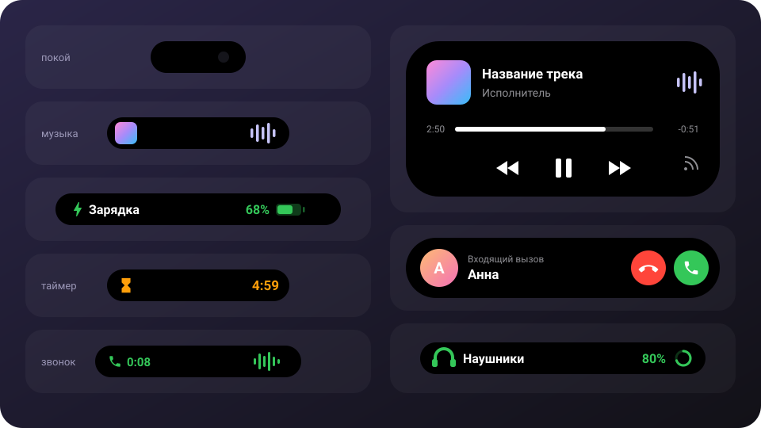

<div align="center">

# 🏝️ Динамический остров для Android

**Dynamic Island в стиле iPhone над камерой любого Android-смартфона**

Музыка с текстом песен · звонки · таймеры · загрузки · зарядка · фонарик · системные события

[](https://github.com/Akira9021/Dynamic-Island-/releases/latest)
[](https://github.com/Akira9021/Dynamic-Island-/releases)
[](https://github.com/Akira9021/Dynamic-Island-/actions)
<br>




### [⬇️ Скачать последнюю версию](https://github.com/Akira9021/Dynamic-Island-/releases/latest)

[Что нового](#-что-нового-в-120) · [Возможности](#-возможности) · [Установка](#-установка) · [Жесты](#-жесты) · [Настройки](#-настройки) · [Как устроено](#-как-устроено)

</div>

---

## ✨ Что нового в 1.2.0

| | |
| --- | --- |
| 📐 **Размеры как у iPhone** | Капсула 126 × 37, боковые части около 52, раскрытый остров почти во всю ширину экрана |
| 🔔 **События во всю ширину** | Зарядка, наушники, Wi-Fi разворачивают остров широкой и высокой плашкой |
| 🎵 **Текст песен** | Вернулся в плеер; ищется на LRCLIB и NetEase, видно «Ищу текст…» / «Не найден» |
| 📞 **Звонки с любой звонилкой** | По состоянию телефона: имя из контактов, ответ и сброс кнопками |

Полный список изменений — в [CHANGELOG.md](CHANGELOG.md).

## 📱 Возможности

<table>
<tr><th>Карточка</th><th>В капсуле</th><th>По нажатию</th></tr>
<tr><td>🎵 <b>Музыка</b></td><td>Обложка слева от камеры, звуковая волна в цвет обложки справа — или строка песни</td><td>Обложка, название, синхронный текст песни, перемотка, ⏪ ⏸ ⏩, вывод звука</td></tr>
<tr><td>📞 <b>Звонки</b></td><td>Входящий — аватар, имя и кнопки сразу; разговор — трубка со временем и волна</td><td>Имя, длительность, «Завершить»</td></tr>
<tr><td>⏳ <b>Таймер</b></td><td>Песочные часы и обратный отсчёт, последние 10 секунд красным</td><td>Кольцо остатка вокруг паузы, отмена; в конце — звонок и вибрация</td></tr>
<tr><td>⏱️ <b>Секундомер</b></td><td>Время</td><td>Пауза, сброс, стоп</td></tr>
<tr><td>⏰ <b>Google Часы</b></td><td>Таймер или секундомер из уведомления, запись экрана — красным</td><td>Крупное время, открыть приложение</td></tr>
<tr><td>⬇️ <b>Загрузки</b></td><td>Значок приложения и кольцо прогресса (Google Play, Telegram…)</td><td>Название, полоса и проценты</td></tr>
<tr><td>🔦 <b>Фонарик</b></td><td>Жёлтый значок</td><td>«Выключить» и яркость фонарика (Android 13+)</td></tr>
<tr><td>🔊 <b>Громкость</b></td><td>Полоса громкости — её можно тянуть пальцем</td><td>—</td></tr>
<tr><td>⚡ <b>Зарядка</b></td><td>Молния, проценты и батарейка</td><td>Полоса заряда</td></tr>
<tr><td>🕐 <b>Пустой остров</b></td><td>Маленькая капсула над камерой</td><td>Часы, дата, заряд, таймер на 1–99 мин, секундомер, фонарик</td></tr>
</table>

Если активностей две — например, музыка и таймер, — вторая уходит в круглый **пузырь** рядом с островом. Нажатие на пузырь раскрывает её.

### 🔔 События

Короткие уведомления в капсуле, каждое включается отдельно:

| | | |
| --- | --- | --- |
| ⚡ Зарядка началась / остановлена | 🪫 Низкий заряд (5%) | 📶 Wi-Fi подключён / отключён |
| 🎧 Наушники подключены / отключены (с зарядом) | ✈️ Режим полёта | 🔕 Звук / вибрация / без звука |
| 🔆 Адаптивная яркость | 🔌 USB-устройство | 🔓 Разблокировка |

## 📥 Установка

1. Скачайте **`DynamicIsland.apk`** со страницы [последнего релиза](https://github.com/Akira9021/Dynamic-Island-/releases/latest) и установите.
2. Откройте приложение → **Спец. возможности** → включите «Динамический остров».
   > На Android 13+ переключатель может быть серым: **О приложении → ⋮ → Разрешить ограниченные настройки**, затем повторите шаг 2.
3. Включите **Доступ к уведомлениям** — без него не будет музыки, загрузок и таймеров Часов.
4. Нажмите **Звонки** и разрешите доступ к телефону, журналу звонков и контактам — тогда остров покажет входящий с любой звонилкой.
5. На Android 12+ разрешите **Bluetooth**, чтобы видеть имена наушников.
6. **Настройки Капсулы → Размер и положение** — подгоните капсулу под вырез камеры.

> [!TIP]
> На Xiaomi, Huawei и Samsung разрешите автозапуск и снимите ограничения батареи, иначе прошивка может выгружать службу.

Новые версии ставятся поверх старых, настройки сохраняются.

## 👆 Жесты

| Действие | Результат |
| --- | --- |
| Нажатие | Раскрыть (можно сменить: открыть приложение, пауза, следующий трек, ничего) |
| Двойное / долгое нажатие | Настраивается, долгое по умолчанию открывает приложение |
| Потянуть вниз | Раскрыть — капсула тянется за пальцем |
| Потянуть вверх, нажатие или касание мимо | Свернуть |
| Толкнуть влево / вправо | Следующий / предыдущий трек |
| Нажатие на звонящий таймер | Выключить звонок |

## ⚙️ Настройки

- **Размер и положение** — ширина, высота, сдвиг и отступ сверху; капсула меняется на экране сразу.
- **Цвет капсулы** — цвет, контур (цвет, толщина, цвет из обложки), тень.
- **Анимации** — стиль раскрытия («Как Фрукт» с эффектом желе, «Пружина», «Плавно», «Без анимации»), длительность, упругость, «Уменьшить эффекты».
- **Динамические карточки** и **события** — каждую можно выключить.
- **Текст песен** — в раскрытом плеере и строкой прямо в капсуле.
- **Виброотклик**, скрытие пустой капсулы, скрытие в альбомной ориентации.

## 🧩 Как устроено

<details>
<summary>Для разработчиков</summary>

<br>

Kotlin, Jetpack Compose, Material 3. Нужны JDK 17 и Android SDK 35.

```bash
./gradlew assembleRelease   # app/build/outputs/apk/release/app-release.apk
```

Каждый push собирает APK в [GitHub Actions](https://github.com/Akira9021/Dynamic-Island-/actions). Чтобы выпустить новую версию, повысьте `versionName` и `versionCode` в `app/build.gradle.kts` и добавьте раздел `## [x.y.z]` в [CHANGELOG.md](CHANGELOG.md) — после push в основную ветку релиз с APK и описанием создастся сам. Тег `v*` тоже работает.

| Файл | За что отвечает |
| --- | --- |
| `service/IslandService.kt` | Служба спец. возможностей и два окна: рисования (на всю ширину, сквозь него проходят касания) и касаний (невидимое, точно над островом) |
| `service/NotifListener.kt` | Доступ к уведомлениям: звонки, загрузки, таймеры из уведомлений |
| `service/MediaMonitor.kt` | Медиасессии любого плеера, обложка и её цвет, текст песен |
| `service/SystemEvents.kt` | Зарядка, Wi-Fi, наушники, режим полёта, звук, яркость, USB, разблокировка |
| `lyrics/LyricsRepo.kt` | Текст песен: [LRCLIB](https://lrclib.net), затем NetEase |
| `service/CallMonitor.kt` | Звонки по состоянию телефона, имя и фото из контактов |
| `island/IslandOverlay.kt` | Выбор главной активности и пузыря, форма, пружины, жесты |
| `island/Compact.kt`, `Expanded.kt` | Свёрнутые и раскрытые виды карточек |
| `ui/` | Приложение настроек |

Почему два окна: если менять размер окна во время анимации, Android на кадр показывает старую картинку в новом месте — и остров дёргается. Поэтому окно рисования не меняет ширину никогда, а невидимое окно касаний двигается за островом и передаёт касания.

Сборки подписываются ключом из `keystore/` — только чтобы новые APK ставились поверх старых.

</details>

## 💜 Благодарности

Идея и поведение — из [Dynamic Island для Windows](https://github.com/mihailkotovski/DynamicIsland) (mihailkotovski): пружинные анимации, плеер по клику, толчок вбок для смены трека, таймер с кольцом, текст песен с LRCLIB. Тексты песен — [LRCLIB](https://lrclib.net).

<div align="center">
<sub>Сделано с <a href="https://claude.ai/code">Claude Code</a></sub>
</div>
